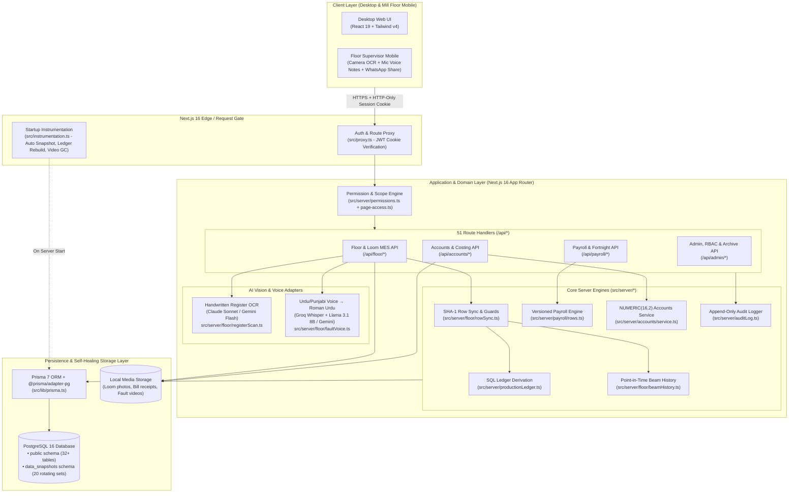
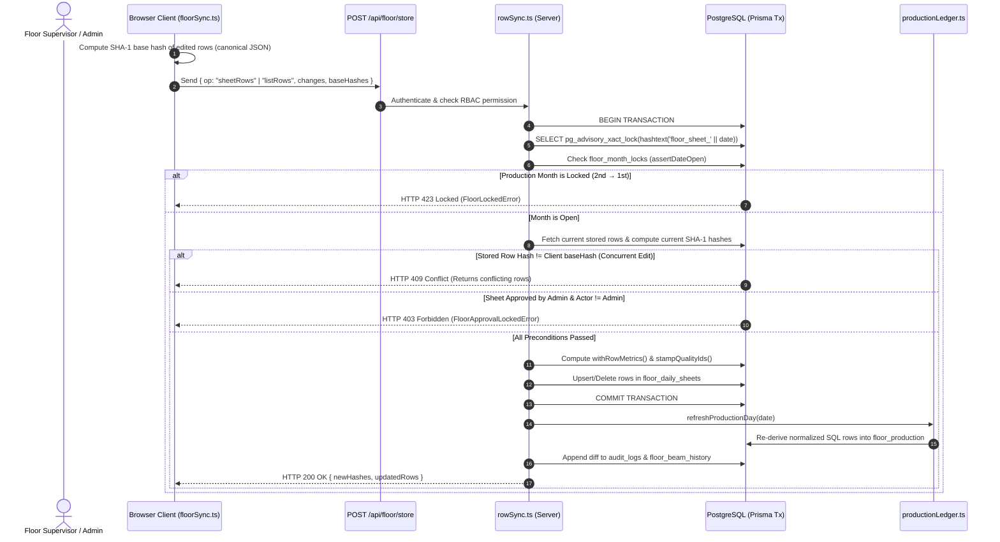
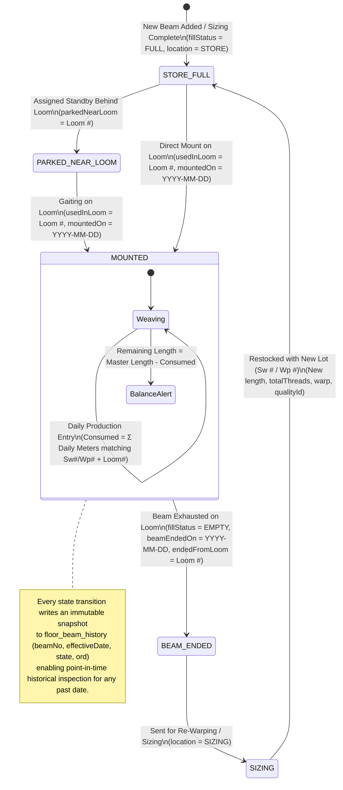
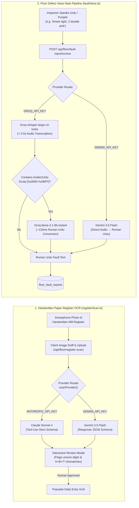

# 🏭 Sara Textile ERP & Manufacturing Execution System (MES)

> **Enterprise Software Architecture, Engineering Specifications, and Codebase Reference (`main` branch)**  
> *Custom-Engineered for Sara Textile Weaving Mills — Industrial Rapier & Projectile Weaving Operations (Looms 1–34)*

---

## 📊 Codebase At a Glance (Verified `main` Branch Metrics)

| Metric | Verified Count / Specification | Source / Verification Path |
| :--- | :--- | :--- |
| **Total Source Code (`src/`)** | **71,735 Lines of TypeScript / TSX** across **~395 files** | `src/**/*.{ts,tsx}` |
| **Application Routes (UI Pages)** | **45+ Interactive Dashboard Views** across 5 Core Domains | `src/app/(dashboard)/**` |
| **Backend API Route Handlers** | **51 RESTful / RPC Endpoints** | `src/app/api/**/route.ts` |
| **Database Tables & Schemas** | **33+ Relational Tables** across `public` & `data_snapshots` schemas | `prisma/schema.prisma` + `src/server/**` |
| **Automated Test Suites** | **22 Vitest Test Suites** (including 1:1 Excel formula parity tests) | `src/__tests__/*.test.ts` |
| **Runtime & Framework** | **Next.js 16.3.5 (App Router)**, **React 19.2**, **TypeScript 5**, **Prisma 7.10** | `package.json` |

---

## 📑 Table of Contents
1. [Executive Summary & Domain Scope](#1-executive-summary--domain-scope)
2. [System Architecture & Diagrams](#2-system-architecture--diagrams)
   - [2.1 High-Level Multi-Tier Architecture](#21-high-level-multi-tier-architecture)
   - [2.2 Row-Level Concurrency, Advisory Locking & Derived Ledger Sequence](#22-row-level-concurrency-advisory-locking--derived-ledger-sequence)
   - [2.3 Beam Lifecycle, Lot (`Sw #` / `Wp #`) & Time-Travel State Machine](#23-beam-lifecycle-lot-sw---wp---time-travel-state-machine)
   - [2.4 AI Vision OCR & Multilingual Voice-to-Roman-Urdu Pipeline](#24-ai-vision-ocr--multilingual-voice-to-roman-urdu-pipeline)
   - [2.5 Complete Database Entity-Relationship Diagram (ERD)](#25-complete-database-entity-relationship-diagram-erd)
3. [Repository Structure & Source Code Map](#3-repository-structure--source-code-map)
4. [Core Engineering Architecture & Distributed Systems Patterns](#4-core-engineering-architecture--distributed-systems-patterns)
5. [Exhaustive Functional Module Reference](#5-exhaustive-functional-module-reference)
   - [5.1 Floor Production, Loom Execution & Custom Production Calendar](#51-floor-production-loom-execution--custom-production-calendar)
   - [5.2 Beam Tracking (`Sw #` / `Wp #`), Sizing & Point-in-Time History](#52-beam-tracking-sw---wp--sizing--point-in-time-history)
   - [5.3 Yarn Inventory & Dual-Unit (`Kg` / `Lbs` / `Bags`) Ledger](#53-yarn-inventory--dual-unit-kg--lbs--bags-ledger)
   - [5.4 Kamran Fault Reporting (Photos, Video & Voice) & Delivery Challans](#54-kamran-fault-reporting-photos-video--voice--delivery-challans)
   - [5.5 Quality Master Catalog & Trigger-Locked Immutable Archive (2020–2026)](#55-quality-master-catalog--trigger-locked-immutable-archive-20202026)
   - [5.6 11-Sheet Fortnightly & Monthly Textile Payroll Engine](#56-11-sheet-fortnightly--monthly-textile-payroll-engine)
   - [5.7 Multi-Entity (`SARA` / `FOI`) Accounts, Party Ledgers & Cost Statements](#57-multi-entity-sara--foi-accounts-party-ledgers--cost-statements)
   - [5.8 Granular RBAC, Security Throttling & Append-Only Audit Trail](#58-granular-rbac-security-throttling--append-only-audit-trail)
6. [Textile Domain Mathematics & Calculation Engines](#6-textile-domain-mathematics--calculation-engines)
7. [Automated Verification & Excel-Parity Test Suite](#7-automated-verification--excel-parity-test-suite)
8. [DevOps, Startup Instrumentation & Deployment Runbooks](#8-devops-startup-instrumentation--deployment-runbooks)
9. [Engineering Work Breakdown Structure (WBS) & Valuation](#9-engineering-work-breakdown-structure-wbs--valuation)

---

## 1. Executive Summary & Domain Scope

**Sara Textile ERP/MES** is a bespoke, full-stack industrial Manufacturing Execution System (MES) and Enterprise Resource Planning (ERP) platform engineered for a weaving mill operating **34 industrial looms** (`G6200` rapier, `PU` projectile, and `G6300` electronic rapier sheds).

Unlike generic CRUD applications or off-the-shelf ERPs, this codebase models the exact physical and financial realities of a Pakistani weaving mill:
* **Custom Production Month Cycle (`2nd → 1st`)**: Production months run from the **2nd of month $M$ through the 1st of month $M+1$** (`src/constants/productionCalendar.ts`), matching physical night-shift closing schedules.
* **Same-Day Multi-Segment Loom Execution**: A single loom can switch fabric qualities mid-day (`segmentIndex = 1, 2, ...`) while maintaining accurate per-segment theoretical meters, running hours, and pick calculations.
* **Shared Warp Lot (`Sw #` / `Wp #`) Multi-Beam Deduction**: Multiple beams warped under the same sizing lot (`Sw # 331` or `Wp # 200`) are disambiguated by mounted/ended loom numbers (`src/services/beamTrack.ts`) so consumption is never double-counted across beams.
* **Zero-Overwrite Multi-User Concurrency**: Simultaneous edits across floor supervisors, payroll clerks, and accountants are protected via **SHA-1 canonical row hashing** (`src/server/floor/rowSync.ts`), **integer row versioning** (`src/server/payroll/rows.ts`, `src/server/accounts/schema.ts`), and **PostgreSQL transactional advisory locks (`pg_advisory_xact_lock`)**.
* **100% Excel Formula Parity**: Verified by automated unit tests against real historical mill Excel workbooks (`contractExcelMatch.test.ts`, `synopsisExcelMatch.test.ts`).

---

## 2. System Architecture & Diagrams

### 2.1 High-Level Multi-Tier Architecture



---

### 2.2 Row-Level Concurrency, Advisory Locking & Derived Ledger Sequence

Every floor save (Daily Production Sheet, Looms, Beams, Qualities) executes inside a serialized PostgreSQL transaction using SHA-1 row hashes to prevent lost updates across multiple browser tabs:



---

### 2.3 Beam Lifecycle, Lot (`Sw #` / `Wp #`) & Time-Travel State Machine



---

### 2.4 AI Vision OCR & Multilingual Voice-to-Roman-Urdu Pipeline



---

### 2.5 Complete Database Entity-Relationship Diagram (ERD)

The system combines declarative Prisma models (`prisma/schema.prisma`) with self-healing runtime DDL tables (`CREATE TABLE IF NOT EXISTS` in `src/server/**`) so production deployments never fail due to schema drift:

```mermaid
erDiagram
    ROLES ||--o{ USERS : assigns
    ROLES ||--o{ ROLE_PERMISSIONS : grants
    ROLES ||--o{ ROLE_MODULE_GRANTS : module_grants
    USERS ||--o{ USER_PERMISSIONS : overrides
    MODULES ||--o{ RESOURCES : contains
    RESOURCES ||--o{ PERMISSIONS : defines
    PERMISSIONS ||--o{ ROLE_PERMISSIONS : linked_in
    PERMISSIONS ||--o{ USER_PERMISSIONS : linked_in

    FLOOR_LOOMS ||--o{ FLOOR_DAILY_SHEETS : "loomNumber (date, segmentIndex)"
    FLOOR_QUALITIES ||--o{ FLOOR_DAILY_SHEETS : "payload.qualityId"
    FLOOR_DAILY_SHEETS ||--|| FLOOR_PRODUCTION : "derived SQL ledger"
    FLOOR_QUALITIES ||--o{ FLOOR_PRODUCTION : "qualityId"
    FLOOR_BEAMS ||--o{ FLOOR_BEAM_HISTORY : "point-in-time state"
    FLOOR_LOOMS ||--o{ FLOOR_FAULT_REPORTS : "Kamran faults (A/B shift)"

    FLOOR_YARNS ||--o{ FLOOR_YARN_MOVEMENTS : "INWARD / OUTWARD"
    FLOOR_YARNS ||--o{ FLOOR_YARN_ISSUANCES : "loom issuances"

    QUALITY_ARCHIVE_FILES ||--o{ QUALITY_ARCHIVE_SHEETS : "xlsx sheets"
    QUALITY_ARCHIVE_FILES ||--o{ QUALITY_ARCHIVE_ROWS : "searchable specs"

    ACC_PARTIES ||--o{ ACC_BILLS : "TRADER / WORKSHOP"
    ACC_BILLS ||--o{ ACC_BILL_LINES : "NUMERIC(16,2) line items"
    ACC_PARTIES ||--o{ ACC_PAYMENTS : "SARA / FOI payments"

    ROLES {
        uuid id PK
        string key UK
        string label
        string department
    }
    USERS {
        uuid id PK
        string email UK
        string roleKey
        enum status "PENDING | APPROVED | REJECTED"
    }
    FLOOR_LOOMS {
        int loomNumber PK
        string model
        string category "G6200 | PU | G6300"
        int defaultRpm
        string status
        string qualityId FK
        boolean isTwinBeam
    }
    FLOOR_BEAMS {
        string beamNo PK
        string warp
        int reed
        float width
        int totalThreads
        float length
        string fillStatus "FULL | EMPTY"
        string usedInLoom
        string swLot "Sw # / Wp #"
        string parkedNearLoom
    }
    FLOOR_DAILY_SHEETS {
        uuid id PK
        string date "YYYY-MM-DD"
        int loomNumber
        int segmentIndex "1 = Primary, 2+ = Dual Quality"
        jsonb payload
    }
    FLOOR_PRODUCTION {
        date date PK
        int loomNumber PK
        int segmentIndex PK
        string qualityId FK
        numeric shiftAMeters
        numeric shiftBMeters
        numeric totalMeters
        numeric theoreticalMeters
        numeric efficiencyPct
    }
    PAYROLL_ROWS {
        string sheet PK "11 sheet keys + __meta"
        string id PK
        string month "YYYY-MM"
        float position
        jsonb payload
        int version "Optimistic Lock"
    }
    ACC_PARTIES {
        string id PK
        string slug UK
        string kind "TRADER | WORKSHOP"
        string account "SARA | FOI"
        string costBucket "MACHINERY | ELECTRIC | REPAIR"
        int version
    }
    ACC_BILLS {
        string id PK
        string partyId FK
        string month "YYYY-MM"
        date date
        jsonb attachments
        int version
    }
    AUDIT_LOGS {
        string id PK
        datetime createdAt
        string actorName
        string module
        string action
        jsonb changes "old -> new diff"
    }
```



---

## 3. Repository Structure & Source Code Map

Any software engineer auditing the repository can navigate directly to the following directories:

```text
sara-textile/
├── prisma/
│   ├── schema.prisma                 # Core PostgreSQL models (RBAC, Floor masters, Stores, AuditLog)
│   └── seed.ts                       # Initial database seeder (Roles, Permissions, Admin user, Looms)
├── src/
│   ├── instrumentation.ts            # Next.js server startup hook (Snapshots, Ledger rebuild, Video GC)
│   ├── proxy.ts                      # Edge request gate & HTTP-only JWT cookie verifier
│   ├── app/
│   │   ├── (dashboard)/
│   │   │   ├── dashboard/            # Executive mill KPI overview
│   │   │   ├── floor/
│   │   │   │   ├── production/       # Main multi-tab MES workspace (Daily Grid, Looms, Beams, Yarn, Qualities)
│   │   │   │   ├── reports/          # Total, Monthly, Weekly, Beam & Data-Check analytical views
│   │   │   │   ├── fault-reports/    # "Kamran Fault" media & voice inspection board
│   │   │   │   └── challan/          # Delivery Challan builder, history & print views
│   │   │   ├── payroll/              # 11-sheet Payroll suite (Weavers, Contract, Staff, Helpers, Advances, Synopsis)
│   │   │   ├── accounts/             # Multi-entity Accounts (Traders, Workshops, Petty Cash, Payables, Cost Statement)
│   │   │   ├── quality-archive/      # Read-only historical Excel workbook browser (2020–2026)
│   │   │   └── admin/                # Users, Roles, Granular Permissions, Approvals, Audit Trail & System Health
│   │   └── api/                      # 51 backend route handlers (/api/floor/*, /api/payroll/*, /api/accounts/*, /api/admin/*)
│   ├── components/
│   │   ├── floor/                    # 45+ specialized MES components (FloorEntryTable, BeamMasterTable, RegisterScanDialog...)
│   │   ├── payroll/                  # Weaver/Contract fortnight tabs, Payslip modals, Salary history, Dirty-state banners
│   │   ├── accounts/                 # PartyLedgerView, BillEditorModal, Photo attachments, PartyDirectory
│   │   ├── challan/                  # ChalanFoiTable & print-ready ChallanPrintPreview
│   │   └── shared/                   # Resizable tables, Pan-scroll, PDF exporters, WhatsApp share modals, MiniCharts
│   ├── server/
│   │   ├── floor/                    # rowSync.ts, beamHistory.ts, beamLotFill.ts, faultReports.ts, faultVoice.ts, registerScan.ts, locks.ts
│   │   ├── payroll/                  # rows.ts (advisory-locked row store), api.ts
│   │   ├── accounts/                 # schema.ts (NUMERIC DDL), repo.ts, service.ts, reports.ts, monthImport.ts, payrollPetty.ts
│   │   ├── archive/                  # qualityArchive.ts (SHA-256 XLSX parser + PL/pgSQL immutability triggers)
│   │   ├── productionLedger.ts       # Normalized SQL derivation engine (floor_daily_sheets -> floor_production)
│   │   ├── dbSnapshot.ts             # In-database point-in-time table snapshots (data_snapshots schema)
│   │   ├── auditLog.ts               # Append-only old->new JSON diff logger
│   │   └── permissions.ts            # RBAC evaluator (Module x Resource x Action x Effect x Scope)
│   ├── services/
│   │   ├── beamTrack.ts              # Sw# / Wp# lot normalization & per-beam consumption calculator
│   │   ├── challanService.ts         # Delivery challan persistence & piece calculations
│   │   ├── payroll/                  # payrollCalculations.ts, contractorPlan.ts, payrollCycles.ts, rosterPlacement.ts
│   │   └── production/               # floorStore.ts, floorSync.ts, qualityRuns.ts, loomBeamHelpers.ts
│   ├── lib/
│   │   ├── floor/                    # rowMetrics.ts, rowSync.ts, dayBuilder.ts, daySummary.ts, generateProductionPdf.ts
│   │   ├── payroll/                  # sync.ts, dataCheck.ts
│   │   ├── accounts/                 # schemas.ts, types.ts, util.ts
│   │   └── archive/                  # xlsx.ts (zero-dependency ZIP/XML XLSX reader), qualityRows.ts
│   └── __tests__/                    # 22 Vitest automated test suites
```

---

## 4. Core Engineering Architecture & Distributed Systems Patterns

### 4.1 Hybrid Document + Relational SQL Ledger (`floor_daily_sheets` $\rightarrow$ `floor_production`)
* **Problem**: Mill floor sheets require flexible, spreadsheet-like editing (custom remarks, dual-quality segments, dynamic fields), which fits JSONB (`floor_daily_sheets`), but aggregating 365 days $\times$ 34 looms in JavaScript causes slow reporting.
* **Solution (`src/server/productionLedger.ts`)**: Every write to `floor_daily_sheets` triggers `refreshProductionDay(date)`, which executes a single native PostgreSQL `INSERT INTO "floor_production" ... SELECT` with a `LATERAL` join that resolves `qualityName` + `pick` + active run dates (`createdOn..endedOn`) to the exact `qualityId`.
* **Self-Healing Guarantee**: On every server boot (`src/instrumentation.ts`), `rebuildProductionLedger()` regenerates the entire relational ledger from the source sheets in milliseconds.

### 4.2 Two-Tier Optimistic Concurrency Control + PostgreSQL Advisory Locks
1. **Floor Production (`src/lib/floor/rowSync.ts` & `src/server/floor/rowSync.ts`)**:
   - Computes a deterministic 24-char SHA-1 hash (`rowHash`) over the canonicalized JSON of every row when loaded by the client.
   - On save, acquires `pg_advisory_xact_lock(hashtext(lockName))` inside a transaction and compares client `baseHashes` against live DB rows. If another supervisor modified Loom 12 in the meantime, only the conflicting row is rejected with HTTP `409 Conflict` while preserving data integrity.
2. **Payroll & Accounts (`src/server/payroll/rows.ts` & `src/server/accounts/repo.ts`)**:
   - Uses monotonic integer `version` columns on every row (`payroll_rows`, `acc_parties`, `acc_bills`, `acc_payments`, `acc_petty_cash`) serialized under PostgreSQL advisory lock `7712002`.

### 4.3 Safety Guards Against Accidental Bulk Wipe (`src/server/floorGuards.ts`)
* Prevents a stale browser cache or buggy client state from accidentally replacing a populated list of looms, beams, qualities, or approved daily sheets with an empty/shrunk array (`assertSafeListReplace`, `assertSafeSheetOverwrite`).

### 4.4 Database-Level Immutability Triggers (`src/server/archive/qualityArchive.ts`)
* Historical Excel workbooks uploaded to the Quality Archive are protected by a PostgreSQL PL/pgSQL trigger (`quality_archive_read_only()`) attached `BEFORE UPDATE OR DELETE OR TRUNCATE` on `quality_archive_files`, `quality_archive_sheets`, and `quality_archive_rows`. Even raw SQL cannot mutate or delete archived records.

### 4.5 Exact Fixed-Point Financial Arithmetic (`src/server/accounts/schema.ts`)
* All accounting tables (`acc_bill_lines`, `acc_payments`, `acc_petty_cash`) store monetary quantities and amounts as PostgreSQL `NUMERIC(16,2)` and `NUMERIC(14,3)` rather than IEEE-754 floats, eliminating rounding drift across multi-month party ledgers.

---

## 5. Exhaustive Functional Module Reference

### 5.1 Floor Production, Loom Execution & Custom Production Calendar
* **34 Loom Fleet**: Categorized into `G6200` (Looms 1–20), `PU` Projectile (Looms 21–26), and `G6300` (Looms 27–34). Note: `PU` projectile looms run twin widths simultaneously, so theoretical capacity automatically applies a `2×` width multiplier (`src/lib/floor/rowMetrics.ts`).
* **Custom Production Calendar (`src/constants/productionCalendar.ts`)**:
  - A production month `YYYY-MM` spans from **`YYYY-MM-02` to `(YYYY-MM+1)-01`** (e.g., September 2026 production runs from `2026-09-02` through `2026-10-01`).
* **Same-Day Dual Quality Segments**: Supports splitting a single loom's day into multiple segments (`segmentIndex = 1, 2...`) when a quality or beam changes mid-shift.
* **Admin Sheet Approval & Month Locks (`src/server/floor/locks.ts`)**:
  - Once Javed Sir (Admin) locks a production month or approves a daily sheet, non-admin edits are blocked at the API boundary with HTTP `423 Locked` / `403 Forbidden`.

### 5.2 Beam Tracking (`Sw #` / `Wp #`), Sizing & Point-in-Time History
* **Lot Normalization (`src/services/beamTrack.ts`)**:
  - Normalizes warp sizing lots (`Sw # 331`, `Wp # 200`) and computes per-beam meter consumption (`buildBeamTrackFromEntries`) bounded by `mountedOn` $\rightarrow$ `beamEndedOn | today` and filtered by the specific loom(s) that beam was mounted on.
* **Automatic Lot Backfill (`src/server/floor/beamLotFill.ts`)**:
  - Synchronizes `Sw #` lot numbers between beam master records and daily production sheet entries.
* **Time-Travel Beam History (`src/server/floor/beamHistory.ts`)**:
  - Records every beam state transition into `floor_beam_history` with fractional ordering (`ord`) so supervisors can inspect the exact beam inventory as of any past date, or insert missed historical beam runs.

### 5.3 Yarn Inventory & Dual-Unit (`Kg` / `Lbs` / `Bags`) Ledger
* **Dual-Unit Engine (`src/lib/floor/yarn.ts` & `src/server/floor/yarn.ts`)**:
  - Tracks yarn stock in **Bags**, **Kilograms (`Kg`)**, and **Pounds (`Lbs`)** simultaneously.
  - Logs `INWARD` (supplier receipts with lot/supplier reference) and `OUTWARD` (floor issuances by loom number and pick density) with date-bounded balance reconstruction (`YarnDateBalance.tsx`).

### 5.4 Kamran Fault Reporting (Photos, Video & Voice) & Delivery Challans
* **Kamran Fault System (`src/server/floor/faultReports.ts`)**:
  - Shift-wise (`Shift A` / `Shift B`) fabric defect logging per loom with multi-photo/video attachments (`FabricFaultMediaDialog.tsx`) and automatic 90-day video retention cleanup (`src/server/floor/faultVideoCleanup.ts`).
  - Voice-to-Roman-Urdu transcription (`src/server/floor/faultVoice.ts`) tailored for Pakistani weaving terminology (*double pick, crack, jaala, kinara, taar, thaan, shot, reed, beam*).
* **Delivery Challans (`src/services/challanService.ts`)**:
  - Roll/piece builder with gross weight, tare deduction, net weight verification, and print-ready A4 Challan templates (`ChallanPrintPreview.tsx`).

### 5.5 Quality Master Catalog & Trigger-Locked Immutable Archive (2020–2026)
* **Active & Archived Fabric Qualities (`src/components/floor/quality/`)**:
  - Tracks fabric recipes (`Reed`, `Pick`, `Width`, `GSM`, `Warp Yarn`, `Weft Yarn`, `Weave Plan`, `Weft Plan`) along with `specHistory`, `yarnHistory`, and `loomEnds`.
* **Immutable Excel Vault (`src/server/archive/qualityArchive.ts`)**:
  - Parses raw `.xlsx` workbooks (`src/lib/archive/xlsx.ts`) cell-by-cell without external native dependencies, verifies file uniqueness via `SHA-256`, and indexes quality rows for instant cross-year search (`/quality-archive`).

### 5.6 11-Sheet Fortnightly & Monthly Textile Payroll Engine
Implemented across `src/services/payroll/` and `src/server/payroll/rows.ts`:
1. **`employees` (Master Profiles)**: CNIC, designation, department, joining/resignation dates, salary history (`EmployeeSalaryHistoryModal.tsx`).
2. **`weavers` (Fortnightly Piece-Rate & Wages)**: Pandrahar (Fortnight 1 & Fortnight 2) wage tabs (`WeaverWagesTab.tsx`), overtime (`WeaverOvertimeTab.tsx`), and net payment (`WeaverNetPaymentTab.tsx`).
3. **`contract` (Contract Floor Labor)**: Fortnightly salary, overtime, and net settlement tabs (`src/components/payroll/contract/`) verified against mill Excel formulas.
4. **`staff` (Monthly Permanent Staff)**: 30-day attendance, base pay, increments, and deductions.
5. **`helpers` (Shift Helpers)**: Helper attendance and wage sheets.
6. **`contractors` (Third-Party Contractors)**: Contractor billing and planner (`contractorPlan.ts`).
7. **`efficiency` (Loom Shed Efficiency Bonuses)**: Tiered incentives linked to shed efficiency.
8. **`advances` (Loan & Advance Ledger)**: Employee advance tracking and automatic salary deduction sync.
9. **`pettyCash` (Payroll Petty Cash)**: Synchronized with the Accounts petty cash ledger (`src/server/accounts/payrollPetty.ts`).
10. **`resigned` (Final Settlement Archive)**: Resigned staff record-keeping and settlement history.
11. **`synopsis` (Executive Disbursement Synopsis)**: Master summary combining all sheets, matched 1:1 with the mill's Excel synopsis workbook.

### 5.7 Multi-Entity (`SARA` / `FOI`) Accounts, Party Ledgers & Cost Statements
Implemented in `src/server/accounts/`:
* **Dual Account Segregation (`SARA` vs `FOI`)**: Every party (`TRADER` or `WORKSHOP`) and payment is tagged by account (`SARA` or `FOI`) and cost bucket (`MACHINERY`, `ELECTRIC`, `REPAIR`).
* **Itemized Bills & Photo Receipts (`BillEditorModal.tsx`)**: Line-level bill entry (`machine`, `description`, `quantity`, `rate`, `amount`) with uploaded bill/cheque photo attachments.
* **Accounts Payable & Trader/Workshop Ledgers (`PartyLedgerView.tsx`)**: Running debit/credit balance with opening balances, adjustments, and monthly purchase reports.
* **Per-Meter Cost Statement (`src/app/(dashboard)/accounts/cost-statement/page.tsx`)**: Combines monthly production meters from the Floor module with machinery, electric, repair, salary, and overhead expenses to compute the exact cost per meter.

### 5.8 Granular RBAC, Security Throttling & Append-Only Audit Trail
* **4-Dimensional Permission Model (`prisma/schema.prisma` & `src/server/permissions.ts`)**:
  - `Module` $\times$ `Resource` $\times$ `Action` (`VIEW`, `CREATE`, `UPDATE`, `DELETE`, `APPROVE`, `POST`, `EXPORT`, `ASSIGN`, `MANAGE`) $\times$ `Effect` (`ALLOW`, `DENY`) $\times$ `Scope` (`ALL`, `OWN`, `DEPARTMENT`, `ASSIGNED`).
* **Brute-Force Login Throttle (`src/server/login-throttle.ts`)**: Tracks failed login attempts by fingerprint in `login_throttles` with automatic temporary lockouts.
* **Append-Only Audit Trail (`src/server/auditLog.ts`)**: Records every mutation across Floor, Payroll, Accounts, and Admin with actor identity, IP address, timestamp, and field-level `old → new` JSON diffs.

---

## 6. Textile Domain Mathematics & Calculation Engines

Implemented in `src/lib/floor/rowMetrics.ts` and `src/lib/floor/daySummary.ts`:

### 1. 100% Theoretical Production Meters ($M_{\text{theo}}$)
$$\text{Theoretical Meters} = \frac{\text{RPM} \times \text{Running Hours} \times 60}{\text{Pick per Inch} \times 39.3701} \times \begin{cases} 2 & \text{if Loom Category} = \text{PU} \\ 1 & \text{otherwise} \end{cases}$$

### 2. Loom & Shed Running Efficiency ($\eta$)
$$\eta_{\text{loom}} = \frac{\text{Shift A Meters} + \text{Shift B Meters}}{\text{Running Theoretical Meters}} \times 100$$
$$\eta_{\text{mill}} = \frac{\sum (\text{Shift A Meters}_i + \text{Shift B Meters}_i)}{\sum \text{Running Theoretical Meters}_i} \times 100$$

### 3. Stop-Loss Meters
$$\text{Stop-Loss Meters} = \max\left(0,\; \text{Theoretical}_{24\text{h}} - \text{Actual Total Meters}\right)$$

### 4. Beam Balance & Lot Consumption (`src/services/beamTrack.ts`)
$$\text{Beam Balance (m)} = \text{Master Beam Length} - \sum_{d \in [\text{mountedOn},\, \text{endedOn}]} \text{Meters}(d, \text{Sw\#}, \text{Loom\#})$$

---

## 7. Automated Verification & Excel-Parity Test Suite

Run the entire 22-suite verification pipeline via Vitest:

```bash
npm test
```

| Test Suite (`src/__tests__/`) | What It Verifies |
| :--- | :--- |
| `contractExcelMatch.test.ts` | Verifies 100% rupee-for-rupee parity between the Contract Payroll engine and historical mill Excel sheets. |
| `synopsisExcelMatch.test.ts` | Verifies 100% parity between the Payroll Synopsis aggregator and the mill's master Excel synopsis. |
| `payrollRows.test.ts` & `payroll.test.ts` | Tests optimistic locking (`409` on version mismatch), fortnight transitions, and row ordering. |
| `floorRowSync.test.ts` & `floorGuards.test.ts` | Tests SHA-1 row hash conflict detection, bulk-overwrite protection guards, and approval locks. |
| `productionLedger.test.ts` | Verifies SQL derivation from `floor_daily_sheets` JSONB to `floor_production` relational columns. |
| `productionMonth.test.ts` | Verifies custom `2nd → 1st` production month boundaries and date range builders. |
| `beamDayHistory.test.ts` & `beamRestockLot.test.ts` | Tests point-in-time beam state reconstruction and `Sw #` / `Wp #` lot restocking. |
| `qualityArchive.test.ts` & `qualityStamp.test.ts` | Tests XLSX parsing, SHA-256 deduplication, and automatic `qualityId` stamping. |
| `accounts.test.ts` | Tests `SARA`/`FOI` party ledgers, itemized bill totals, petty cash sync, and month locks. |
| `registerScan.test.ts` & `faultReports.test.ts` | Tests AI OCR schema validation, shift A/B fault report filtering, and media sanitization. |
| `auditLog.test.ts` & `accessDefaults.test.ts` | Tests `old → new` diff computation and default role permission matrices. |

---

## 8. DevOps, Startup Instrumentation & Deployment Runbooks

### 8.1 Automatic Startup Instrumentation (`src/instrumentation.ts`)
Whenever the Node.js server starts (after a deploy or restart), `register()` automatically executes:
1. **Environment Validation (`src/lib/env.ts`)**: Validates required runtime secrets.
2. **Pre-Deploy In-DB Snapshot (`src/server/dbSnapshot.ts`)**: Copies all 18 business tables into the `data_snapshots` schema (`<table>__YYYYMMDD_HHMM`), keeping the latest 20 snapshot sets so any deployment issue can be rolled back with a single SQL statement.
3. **90-Day Fault Video Garbage Collector (`src/server/floor/faultVideoCleanup.ts`)**: Schedules daily cleanup of old inspection videos to protect disk space while keeping fault text and photos permanently.
4. **Normalized Ledger Rebuild & `qualityId` Backfill**: Rebuilds `floor_production` and stamps any missing `qualityId` references.

### 8.2 Local Development Setup

```bash
# 1. Install dependencies (Node.js 20+ LTS)
npm install

# 2. Configure environment variables (.env)
# Required: DATABASE_URL, JWT_SECRET
# Optional AI features: ANTHROPIC_API_KEY, GEMINI_API_KEY, GROQ_API_KEY

# 3. Push Prisma schema & seed initial roles/looms
npm run db:push
npm run seed

# 4. Run typecheck & unit tests
npm run typecheck
npm test

# 5. Start development server
npm run dev
```

### 8.3 Production Build & Execution

```bash
# Generate Prisma client and build Next.js production bundle
npm run build

# Start custom production server
npm start
```

---

## 9. Engineering Work Breakdown Structure (WBS) & Valuation

For software engineering leads, technical auditors, and stakeholders evaluating the scope of this repository (**71,735 LOC**, **~395 files**, **51 APIs**, **22 test suites**):

| # | Engineering Workstream | Frontend UI/UX (Hrs) | Backend & Domain Logic (Hrs) | DB Schema, Triggers & Sync (Hrs) | Automated QA & Excel Parity (Hrs) | Total Effort (Hrs) |
| :-: | :--- | :-: | :-: | :-: | :-: | :-: |
| **1** | **Floor MES & Daily Loom Grid** *(34 looms, dual-quality segments, 2nd→1st calendar, PDF/WhatsApp export)* | 65 | 75 | 30 | 25 | **195** |
| **2** | **Row-Level SHA-1 Sync, Guards & SQL Ledger** *(Optimistic locking, advisory locks, `floor_production` derivation)* | 25 | 55 | 30 | 25 | **135** |
| **3** | **Beam Lifecycle, `Sw #`/`Wp #` Tracker & Time-Travel History** *(Gaiting, lot disambiguation, `floor_beam_history`)* | 40 | 45 | 20 | 20 | **125** |
| **4** | **AI Register OCR & Multilingual Voice Fault System** *(Claude/Gemini OCR, Groq Whisper + Llama Roman Urdu, media GC)* | 40 | 45 | 15 | 20 | **120** |
| **5** | **Yarn Dual-Unit Inventory & Delivery Challans** *(Kg/Lbs/Bags ledger, loom issuances, piece builder, print views)* | 45 | 40 | 15 | 15 | **115** |
| **6** | **Quality Master Catalog & Immutable XLSX Archive** *(Spec/yarn history, zero-dep XLSX parser, PL/pgSQL read-only triggers)* | 35 | 35 | 20 | 15 | **105** |
| **7** | **11-Sheet Fortnightly & Monthly Payroll Engine** *(Weavers, Contract, Staff, Helpers, Advances, Synopsis, Excel parity)* | 80 | 90 | 30 | 40 | **240** |
| **8** | **Multi-Entity (`SARA`/`FOI`) Accounts & Cost Statement** *(Traders/Workshops, itemized bills, petty cash sync, per-meter cost)* | 60 | 65 | 25 | 20 | **170** |
| **9** | **Enterprise RBAC, Security & Append-Only Audit Trail** *(4D permissions, login throttling, `old→new` diff logs, snapshots)* | 35 | 45 | 25 | 15 | **120** |
| | **TOTAL ENGINEERING EFFORT** | **425 Hrs** | **495 Hrs** | **210 Hrs** | **195 Hrs** | **1,325 Hours** |

---

## 📜 License & Intellectual Property
Proprietary software custom-engineered for **Sara Textile Weaving Mills**. Unauthorized copying, distribution, or commercial reuse of the textile calculation engines, database schemas, or source code is strictly prohibited.
